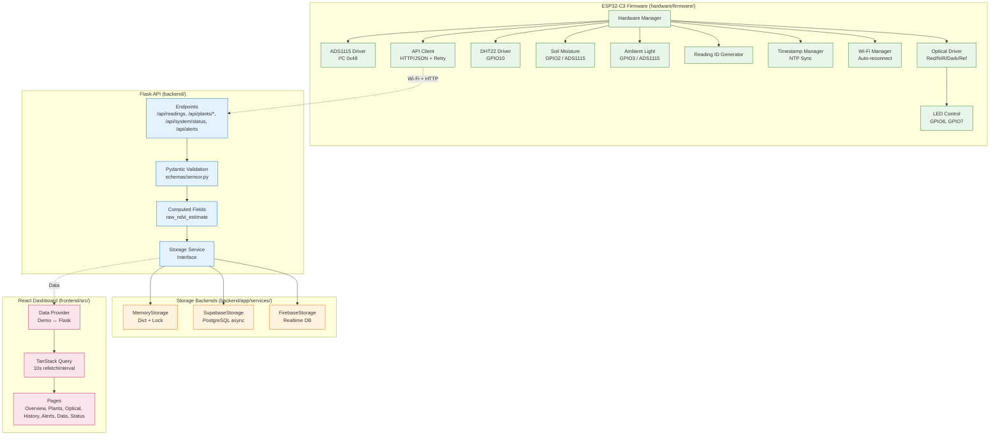
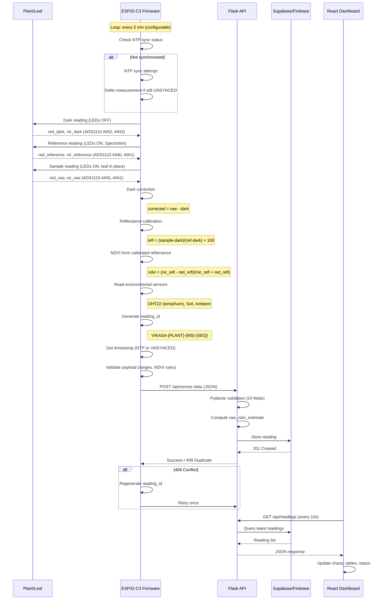

# Vikāsa System Architecture

> **Scope**: This document describes the **implemented** architecture with a visual Mermaid diagram. For detailed component responsibilities, see [`system_architecture.md`](system_architecture.md).

---

## High-Level Data Flow

```mermaid
flowchart LR
    subgraph Edge["ESP32-C3 Edge Node (Firmware)"]
        H[Plant Canopy] --> O[Optical Sensors<br/>BPW34 + AFE → ADS1115]
        H --> E[Environmental Sensors<br/>DHT22, Soil Moisture, Ambient Light]
        O --> F[Firmware Core<br/>Dark/Ref Correction → Reflectance → NDVI]
        E --> F
        F --> ID[Reading ID Gen<br/>VIKASA-{PLANT}-{MS}-{SEQ}]
        F --> TS[Timestamp Manager<br/>NTP + UNSYNCED State]
        F --> W[Wi-Fi Manager<br/>Auto-reconnect]
        ID --> API[API Client<br/>HTTP/JSON POST]
        TS --> API
        W --> API
    end

    subgraph Cloud["Backend & Storage"]
        API -->|POST /api/sensor-data| FL[Flask REST API<br/>Pydantic Validation]
        FL -->|raw_ndvi_estimate| FL
        FL --> ST[Storage Abstraction<br/>StorageService Interface]
        ST --> MEM[(In-Memory<br/>Dev Default)]
        ST --> SB[(Supabase<br/>PostgreSQL + RLS)]
        ST --> FB[(Firebase<br/>Realtime DB Legacy)]
    end

    subgraph UI["React Dashboard (Frontend)"]
        SB --> POLL[10s Polling<br/>TanStack Query]
        MEM --> POLL
        FB --> POLL
        POLL --> DASH[Dashboard Pages<br/>Overview, Plants, Optical, History, Alerts, Data, Status]
    end

    style Edge fill:#e8f5e9,stroke:#2e7d32
    style Cloud fill:#e3f2fd,stroke:#1565c0
    style UI fill:#fce4ec,stroke:#c2185b
```

---

## Component Diagram



---

## Sequence Diagram: Measurement Cycle



---

## Key Architectural Decisions

| Decision | Implementation | Rationale |
|----------|----------------|-----------|
| **Raw vs Calibrated Separation** | Separate fields: `red_raw`/`nir_raw` (ADC) vs `red_reflectance`/`nir_reflectance` (%) | Prevents conflation; enables audit trail |
| **NDVI Source** | Only from calibrated reflectance; backend validates pairwise requirement | Raw ADC NDVI is an estimate only (`raw_ndvi_estimate`) |
| **Timestamp Honesty** | Explicit `UNSYNCED` state; never fabricates timestamps | Data integrity for time-series analysis |
| **Reading ID** | Device-generated deterministic format `VIKASA-{PLANT}-{MS}-{SEQ}` | Enables duplicate detection without central coordinator |
| **Storage Abstraction** | `StorageService` interface with Memory/Supabase/Firebase implementations | Swappable via `STORAGE_BACKEND` env var |
| **Polling** | Frontend 10s interval via TanStack Query `refetchInterval` | Near-real-time UX without WebSocket complexity |
| **Secrets** | Never committed: `secrets.h` (firmware), `.env` (backend), `.env.local` (frontend) | Gitignored templates provided |

---

## API Contract Summary

| Endpoint | Method | Description |
|----------|--------|-------------|
| `/api/health` | GET | Backend + storage health |
| `/api/readings` | POST | Create reading (alias: `/api/sensor-data`) |
| `/api/readings/latest` | GET | Latest reading (optional `plant_id`) |
| `/api/readings` | GET | Paginated history with filters |
| `/api/plants/summaries` | GET | Per-plant summaries |
| `/api/plants/<plant_id>/status` | GET | Plant status + latest reading |
| `/api/system/status` | GET | Connectivity (honest: `esp32: "unknown"`) |
| `/api/alerts` | GET | Alert history (currently empty, `generated: false`) |

**Schema**: 24 fields matching `backend/app/schemas/sensor.py` and `data/raw/hardware/vikasa_sensor_data_template.csv`

---

## Development vs Production

| Aspect | Development | Production |
|--------|-------------|------------|
| Storage | In-memory (`STORAGE_BACKEND=memory`) | Supabase (`STORAGE_BACKEND=supabase`) |
| Firmware | `DEVELOPMENT_MODE=1` (stub drivers, test payloads) | `DEVELOPMENT_MODE=0` (real hardware) |
| Frontend | Demo data provider | Flask provider via `VITE_API_BASE_URL` |
| Auth | None | Required (not yet implemented) |

---

## Related Documentation

- [System Architecture Details](system_architecture.md) — Component roles, verified status, future work
- [Firmware Documentation](firmware.md) — Payload, IDs, timestamps, Wi-Fi, retry, optical rules
- [API Reference](api.md) — Complete endpoint documentation with examples
- [Hardware Setup](hardware_setup.md) — Preliminary design notes (unverified)
- [Data Collection Protocol](data_collection_protocol.md) — Proposed workflow and CSV schema

---

*Last updated: 2026-10-20. Reflects repository state as of commit `HEAD`.*