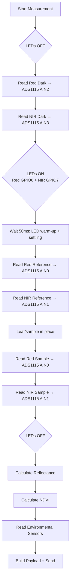

# Vikāsa Hardware Documentation

> **Scope**: Documents the **implemented** hardware interfaces in firmware, verified pin assignments, and wiring considerations. Clearly flags unverified physical behavior and calibration requirements.
>
> **Status**: Firmware drivers are implemented and compile. Physical circuit has **not been validated**. No hardware test results are claimed.

---

## Bill of Materials (Implemented in Firmware)

| Component | Part / Interface | Role | Driver Status |
|-----------|------------------|------|---------------|
| **MCU** | ESP32-C3-MINI-1-N4 (PCB CUPID GLYPH C3) | Main controller, Wi-Fi, ADC, I²C | ✅ Firmware compiles |
| **ADC** | ADS1115 (I²C 0x48) | 16-bit ADC for optical + optional soil/ambient | ✅ Implemented |
| **Red Optical** | BPW34 photodiode + TIA → ADS1115 AIN0 | 660 nm reflectance sample/reference | ✅ Implemented |
| **NIR Optical** | BPW34 photodiode + TIA → ADS1115 AIN1 | 940 nm reflectance sample/reference | ✅ Implemented |
| **Red Dark** | BPW34 + TIA → ADS1115 AIN2 | Dark current for red channel | ✅ Implemented |
| **NIR Dark** | BPW34 + TIA → ADS1115 AIN3 | Dark current for NIR channel | ✅ Implemented |
| **Temperature/Humidity** | DHT22 (AM2302) | Environmental monitoring | ✅ Implemented |
| **Soil Moisture** | Resistive probe → ESP32 ADC (GPIO2) *or* ADS1115 AIN2 | Soil volumetric water content | ✅ Implemented |
| **Ambient Light** | LDR → ESP32 ADC (GPIO3) *or* ADS1115 AIN3 | Illuminance context | ✅ Implemented |
| **Red LED** | ~660 nm, GPIO6 | Active illumination for red channel | ✅ Implemented |
| **NIR LED** | ~940 nm, GPIO7 | Active illumination for NIR channel | ✅ Implemented |

---

## Verified Pin Assignments (from `hardware/firmware/include/config.h`)

### ESP32-C3 GPIOs

| GPIO | Signal | Notes |
|------|--------|-------|
| **GPIO4** | I²C SDA | ADS1115 communication (400 kHz) |
| **GPIO5** | I²C SCL | ADS1115 communication (400 kHz) |
| **GPIO6** | Red LED | Active-high illumination (red ~660 nm) |
| **GPIO7** | NIR LED | Active-high illumination (NIR ~940 nm) |
| **GPIO10** | DHT22 | 1-Wire temperature/humidity sensor |
| **GPIO2** | Soil Moisture ADC | ESP32 ADC1_CH1 (default for soil) |
| **GPIO3** | Ambient Light ADC | ESP32 ADC1_CH2 (default for ambient) |

### ADS1115 Channels (4 Single-Ended)

| ADS1115 Channel | Primary Purpose | Shared With | Notes |
|-----------------|-----------------|-------------|-------|
| **AIN0** | Red Sample / Red Reference | — | Time-multiplexed: reference measured with Spectralon in place |
| **AIN1** | NIR Sample / NIR Reference | — | Time-multiplexed: reference measured with Spectralon in place |
| **AIN2** | Red Dark | Soil Moisture (if on ADS1115) | Dark current for red; soil shares channel — requires mux or separate ADC |
| **AIN3** | NIR Dark | Ambient Light (if on ADS1115) | Dark current for NIR; ambient shares channel — requires mux or separate ADC |

> **Constraint**: ADS1115 has only 4 single-ended channels. Reference measurements reuse AIN0/AIN1 at different times. Soil/ambient on ADS1115 would share dark channels — current firmware defaults use ESP32 ADC for soil/ambient to avoid conflicts.

---

## Measurement Sequence (Implemented in Firmware)



**Implemented in**: `hardware/firmware/src/hardware_interfaces.cpp` → `optical_measure_all()`

---

## Reflectance Calculation (Implemented)

```cpp
// Dark correction
red_corrected     = red_raw     - red_dark;
nir_corrected     = nir_raw     - nir_dark;
red_ref_corrected = red_reference - red_dark;
nir_ref_corrected = nir_reference - nir_dark;

// Reflectance percentage (0–100%)
red_reflectance  = (red_corrected     / red_ref_corrected)  * 100;
nir_reflectance  = (nir_corrected     / nir_ref_corrected)  * 100;

// NDVI from CALIBRATED reflectance only (normalized to 0–1)
red_refl = red_reflectance  / 100.0;
nir_refl = nir_reflectance  / 100.0;
ndvi     = (nir_refl - red_refl) / (nir_refl + red_refl);  // Clamped [-1, 1]
```

**Enforced rules** (compile-time + runtime):
- Raw ADC ≠ Reflectance — never compute `raw / 65535 * 100`
- Dark correction mandatory — all four dark/sample/reference readings required
- Reference standard required — cannot calibrate without Spectralon (or equivalent)
- NDVI only from calibrated reflectance — backend validates pairwise requirement

---

## Environmental Sensor Details

### DHT22 (Temperature/Humidity)
- **Interface**: GPIO10 (1-Wire)
- **Library**: Adafruit DHT sensor library
- **Output**: `temperature_c` (-50 to 100°C), `humidity_pct` (0–100%)
- **Calibration**: Factory calibrated — no user calibration needed
- **Caveat**: 1-Wire timing sensitive; 2s minimum between reads

### Soil Moisture
- **Default Interface**: ESP32 ADC1_CH1 (GPIO2)
- **Optional Interface**: ADS1115 AIN2 (shared with Red Dark — requires mux)
- **Calibration Required**: `dry_raw` (ADC in dry soil) and `wet_raw` (ADC in saturated soil)
- **Current Defaults**: `dry_raw=3000`, `wet_raw=1000` — **PLACEHOLDERS, NOT CALIBRATED**
- **Formula**: `moisture_pct = 100 * (raw_adc - dry_raw) / (wet_raw - dry_raw)` clamped 0–100%

### Ambient Light (LDR)
- **Default Interface**: ESP32 ADC1_CH2 (GPIO3)
- **Optional Interface**: ADS1115 AIN3 (shared with NIR Dark — requires mux)
- **Calibration Required**: `lux_per_adc` factor for lux conversion
- **Current Default**: `lux_per_adc = 1.0` — **PLACEHOLDER, NOT CALIBRATED**
- **Output**: `ambient_light_raw` (ADC), `lux` (if calibrated)

---

## Wiring Considerations

### I²C Bus (ADS1115)
- **Pull-up resistors required** on SDA (GPIO4) and SCL (GPIO5) — typically 4.7 kΩ to 3.3V
- **Bus speed**: 400 kHz (configured in firmware)
- **Address**: 0x48 (ADDR pin to GND)
- **Cable length**: Keep < 30 cm for 400 kHz; use twisted pair for longer runs

### LED Drive (Red GPIO6, NIR GPIO7)
- **Current firmware**: Direct GPIO drive (active-high)
- **Limitation**: No constant-current driver — LED current varies with Vf, temperature, supply voltage
- **Production need**: Constant-current LED driver (e.g., AMC7135, CAT4101, or discrete MOSFET + sense resistor)
- **Power**: Ensure 3.3V supply can source peak LED current (typically 20–50 mA per LED)

### Optical Front-End (Not Yet Validated)
```
BPW34 Photodiode → Transimpedance Amplifier (TIA) → ADS1115 AIN
```
- **TIA design required**: Gain selection (e.g., 100 kΩ feedback = 100 mV/µA)
- **Dark offset**: Measured with LEDs off; subtracted in firmware
- **Bandwidth**: Must settle within measurement window (currently 50ms LED warm-up + read time)
- **Noise**: Shield photodiode + TIA from LED switching noise; guard rings recommended

### ADC Channel Sharing Conflicts
| Conflict | Current Resolution | Production Options |
|----------|-------------------|-------------------|
| Red Dark (AIN2) ↔ Soil Moisture | Soil on ESP32 ADC (GPIO2) | Add I²C mux (TCA9548A) or 2nd ADS1115 |
| NIR Dark (AIN3) ↔ Ambient Light | Ambient on ESP32 ADC (GPIO3) | Add I²C mux or 2nd ADS1115 |
| Red Sample ↔ Red Reference | Time-multiplexed (same channel) | Validated in firmware sequence |
| NIR Sample ↔ NIR Reference | Time-multiplexed (same channel) | Validated in firmware sequence |

---

## Power Considerations

| Rail | Consumers | Notes |
|------|-----------|-------|
| **3.3V** | ESP32-C3, ADS1115, DHT22, LEDs, TIA op-amps | ESP32-C3 peak ~200 mA (Wi-Fi TX); budget for 500 mA+ |
| **LED Supply** | Red LED, NIR LED | Separate from logic if possible; constant-current driver recommended |

- **No battery management implemented** — firmware has no battery monitor, fuel gauge, or deep sleep
- **No reverse-polarity or input protection** — prototype only

---

## Calibration Requirements (All Unverified)

| Parameter | Purpose | Current Status | Validation Needed |
|-----------|---------|----------------|-------------------|
| `red_transimpedance_gain` | TIA V/A for red channel | 100 kΩ (placeholder) | Measure with known current source |
| `nir_transimpedance_gain` | TIA V/A for NIR channel | 100 kΩ (placeholder) | Measure with known current source |
| `red_dark_offset` | ADC counts at zero light | 0 (placeholder) | Measure in dark enclosure |
| `nir_dark_offset` | ADC counts at zero light | 0 (placeholder) | Measure in dark enclosure |
| **Reference Standard** | Spectralon or calibrated diffuse reflector | **Not procured** | Traceable to NIST/ISO standard |
| `dry_raw` / `wet_raw` | Soil moisture ADC endpoints | 3000 / 1000 (placeholder) | Gravimetric calibration in target soil |
| `lux_per_adc` | Ambient light ADC → lux | 1.0 (placeholder) | Calibrate against lux meter |
| **Temperature compensation** | Optical sensor drift vs temperature | Not implemented | Characterize -10°C to +50°C |

---

## 3D-Printable Mount

- **Model**: `3d_Prints/leaf_mount.stl` (see [`3d_Prints/README.md`](../3d_Prints/README.md))
- **Purpose**: Repeatable leaf positioning for optical measurements
- **Status**: Model exists; print and fit not validated

---

## Unverified / Future Hardware Work

| Item | Description |
|------|-------------|
| **Custom PCB** | Integrate ESP32-C3, ADS1115, TIA, LED drivers, power regulation, connectors |
| **Transimpedance Amplifier** | Design, layout, noise characterization, gain selection |
| **LED Driver Circuit** | Constant-current, thermal stability, PWM or DC drive |
| **Reference Standard** | Procure Spectralon; define handling, cleaning, storage procedure |
| **Channel Multiplexer** | TCA9548A or 2nd ADS1115 for soil/ambient on ADC |
| **Enclosure** | IP65+, optical window material (acrylic/glass), cable glands, vent |
| **Battery/Solar** | LiFePO₄ + charging IC + fuel gauge (MAX17048) + deep sleep firmware |
| **Environmental Tests** | Thermal cycling, humidity, UV exposure, vibration |

---

## Related Documentation

- [Hardware Setup Notes](hardware_setup.md) — Preliminary design checklist (unverified)
- [Firmware Documentation](firmware.md) — Driver interfaces, payload, optical rules, build commands
- [System Architecture](system_architecture.md) — Component roles and data flow
- [Roadmap](../ROADMAP.md) — Phased hardware improvement priorities

---

*Last updated: 2026-10-20. Pin assignments and driver implementations reflect `config.h` and `hardware_interfaces.cpp` at commit `HEAD`. Physical circuit validation pending.*